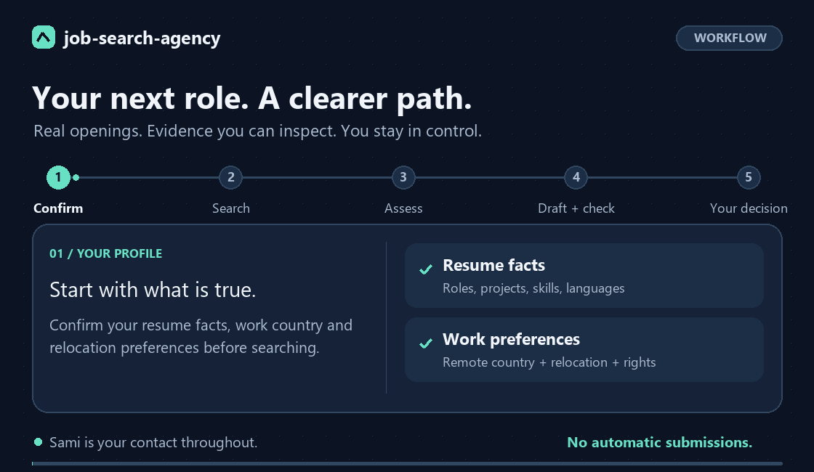

# job-search-agency

A local job-search assistant: find openings, explain eligibility and skill gaps,
prepare truthful resumes, then stop for the person's decision.

**Release:** [v0.3.0](https://github.com/MohamedAliTrabelsiSE/job-search-agency/releases/tag/v0.3.0)
— [what changed](CHANGELOG.md). Existing users should review the upgrade notes.

<picture>
  <source media="(prefers-reduced-motion: reduce)" srcset="docs/workflow-overview.png">
  
</picture>

[View the static workflow overview](docs/workflow-overview.png).

Sami is your contact. Ida reads mail; Remy, Nico, Lina and Esme search; Theo ranks;
Maya drafts and Marco checks. The names label workflow stages. The core pipeline
is deterministic Python, not a collection of autonomous model agents.

## Start

Python 3.11+, `python-docx`, and LibreOffice or Microsoft Word for PDFs:

```powershell
pip install -r requirements.txt
python -m unittest discover -s tests -p "test_*.py"
python src/demo.py --root tmp/demo
```

On Windows use `py -3`, or `.venv\Scripts\python.exe` if the launcher is unavailable.
The demo uses a fictional candidate and jobs. It makes no network requests, reads
no mail, and submits nothing. Add `--no-render` to test decisions without a PDF
converter. Use the [manual checks](docs/manual-testing.md) to verify your setup.
Contributors should complete them before merging or publishing changes.
[Implementation plan](docs/implementation-plan.md).

## Onboarding

Open the repo in your coding assistant and follow [AGENTS.md](AGENTS.md). It asks
for a general resume, reads back its facts for confirmation, then asks remote or
relocation preferences and work-right needs. Save these privately under `data/`.

```powershell
python src/profile.py show
python src/profile.py confirm --name "YOUR EXACT NAME"
python src/preview_cv.py
```

Confirmation is bound to the exact JSON contents. Changed facts/preferences require
another review. Existing files alone cannot start a search. `profile.py fresh-start`
archives profile/history without deleting earlier resumes. Never commit a real CV.

## A search

```powershell
python src/morning.py --skip-inbox
```

Omit `--skip-inbox` to let Ida read mail when `~/.dsh/smtp.txt` exists (address,
then app password). She never sends. New search artifacts live in
`data/runs/<run-id>/`; `data/latest-run.json` points to the processed run. The run
contains source health, pool, shortlist, reviews, summary and the file handoff.
Resumes live in `outbox/<run-id>/<company-role-job-id>/`.

The search covers seed and runtime-discovered public Ashby, Lever and Greenhouse boards. It reports
healthy/failed boards and description-fetch failures. **No matches is not proof
that no jobs exist.** An all-source failure cannot replace the last successful run.

Eligibility separates permitted countries, visa sponsorship and relocation help.
Each conclusion has evidence; uncertainty stays visible. Technical matching shows
matched skills, missing required skills and experience evidence. Scores are
deterministic overlap heuristics, not probabilities or employer assessments.

| Decision | Result |
| --- | --- |
| recommended | Understood requirements, supported essential expertise, no extracted gaps, eligible location |
| stretch | Minor skill or bounded experience gap; essential expertise is supported |
| needs_verification | Eligibility, requirements or experience evidence is unresolved; no resume yet |
| excluded | Explicit incompatibility, substantial experience gap, missing essential expertise, or no technical overlap |

Required, preferred and one-of alternatives retain section evidence. Preferred
skills never become mandatory just because they say "experience with". A two-year
candidate meets a two-year minimum, may stretch to three, and is excluded for
five/eight/twenty years. The default experience stretch permits at most one year
and requires at least two-thirds of the stated duration; customize
`matching_policy.max_experience_gap` and `matching_policy.min_experience_ratio`
in confirmed preferences. Scores include experience penalties. Technology overlap
alone cannot establish a recommendation when requirements are not understood.

All distinct job URLs stay available; multiple openings at one company can survive.
Legacy `roles.json` company exclusions remain supported. New application history
uses job URLs, so one duplicate opening need not suppress all future company jobs.

## Resumes

The renderer fills `templates/professional.docx`. All roles, projects, source
bullets, education and spoken languages stay. Automated bullets are copied from
confirmed facts and reordered; arbitrary rewrites require factual review.

Each job folder has `card.json`, `cv.json`, `ats.json`, `resume.pdf`, `resume.docx`,
and `resume.txt` when rendering succeeds. The PDF is the application file; DOCX is
the same content. Failed conversion preserves earlier successful files.

`ats.json` reports factual checks, gaps and rendering separately. It does not
claim to reproduce an employer's ATS, guarantee selection, or replace visual PDF
inspection. Another layout requires a confirmed `template_override` preference.

## Sources

```powershell
python src/source_health.py
```

Source lists are under `config/sources/`. The committed
[validation snapshot](config/source-health.snapshot.json) records a dated public
endpoint check. Active boards can change or return zero jobs. Run the health check
again rather than assuming a snapshot proves current availability. All scout
requests share one eight-request limit. Fetches retry transient failures only.

Regions currently cover Germany/Austria, Netherlands/Belgium/Ireland and the
Nordics; selecting another country does not automatically add sources for it.

### Discover employers beyond the seed list

The coding assistant uses its public web-search tool, then imports the result
URLs. The CLI does not scrape search engines or pretend to have a search service.

```powershell
python src/employers.py queries
# Assistant executes those searches and saves results privately.
python src/employers.py import --results tmp/public-search-results.json
python src/morning.py --skip-inbox
```

Input shape: `{"queries":["query"],"results":[{"url":"https://jobs.ashbyhq.com/company/job-id","query":"query","scouts":["worldwide"]}]}`.
Use `dach`, `benelux-ie` or `nordics` for relocation search results as appropriate.
Supported official ATS URLs are parsed, deduplicated and verified against their
public feeds. Imported boards live in private `data/employer-discovery.json`,
expire after seven days, and are merged at runtime without editing the seed list.
Each run reports `market_discovery` separately from board health. Without search
evidence, it explicitly reports **seed_only** coverage. Even expanded search is
not exhaustive. Unsupported/custom career hosts are reported for review.

Posting age is separate from availability: each fetched ad is `observed_listed`,
not guaranteed accepting applications. Dates are recent/older/unknown. Default
`freshness_mode: prefer` retains older and undated listed jobs; `recent_only`
filters known older dates using `cutoff_days` while retaining unknown dates visibly.

## Application preparation and history

`src/applications.py --help` exposes local preflight and outcome recording. It
collects salary/currency, availability, education category and sponsorship needs,
checks previous job-level applications, and requires explicit approval before a
submitted outcome can be recorded. An observed result supplies evidence.

These commands do not submit anything. `src/send.py` deliberately refuses to send;
there is no LinkedIn client or auto-apply browser. See [safety](docs/safety.md).

## Development

Tests use fictional facts and injected public-API fixtures. CI runs logic tests
and the offline demo on Windows and Linux. Local PDF rendering and visual review
remain separate acceptance checks. Private JSON, SQLite history, outbox files and
temporary page images are gitignored.

The README artwork is generated from [a small rendering script](tools/render_readme_animation.py).
See [visual asset notes](docs/visuals.md) to regenerate it; Pillow is optional and
is not required to run the job-search pipeline.

Repo [skills](skills/job-research/SKILL.md) are routed by AGENTS.md; they are not
installed globally by this project. Keep [manual test results](docs/manual-testing.md)
under ignored `tmp/` and publish only after reviewing the diff for private data.

## Known limits

Country aliases, required-skill extraction and experience parsing are conservative
heuristics, not legal advice or semantic understanding. Unrecognized requirements
can be missed. Read the full ad and verify ambiguous eligibility with the employer.
The optional freshness filter uses source timestamps; Greenhouse timestamps mean
updated, not necessarily first published. Unknown geographic restrictions require
verification rather than permission. Mail classification and legacy company
exclusions can be coarse. Resume checks deliberately block unsupported rewrites.

MIT licence. Feedback: [issues](https://github.com/MohamedAliTrabelsiSE/job-search-agency/issues)
or [discussions](https://github.com/MohamedAliTrabelsiSE/job-search-agency/discussions).
