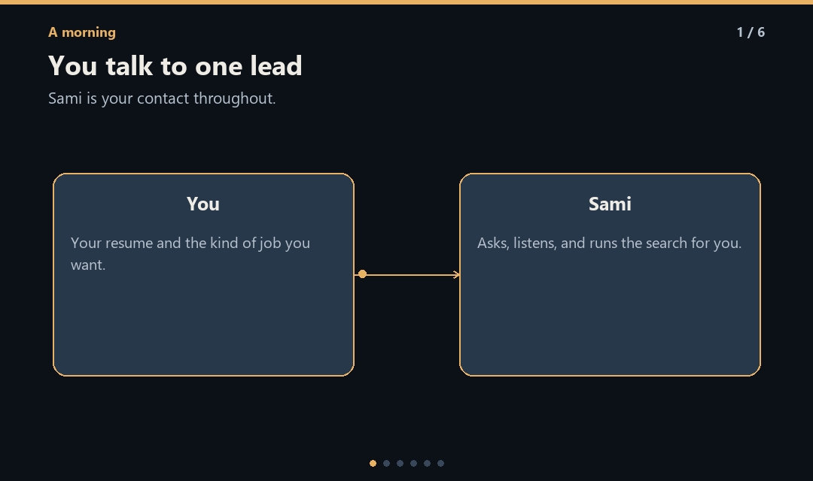
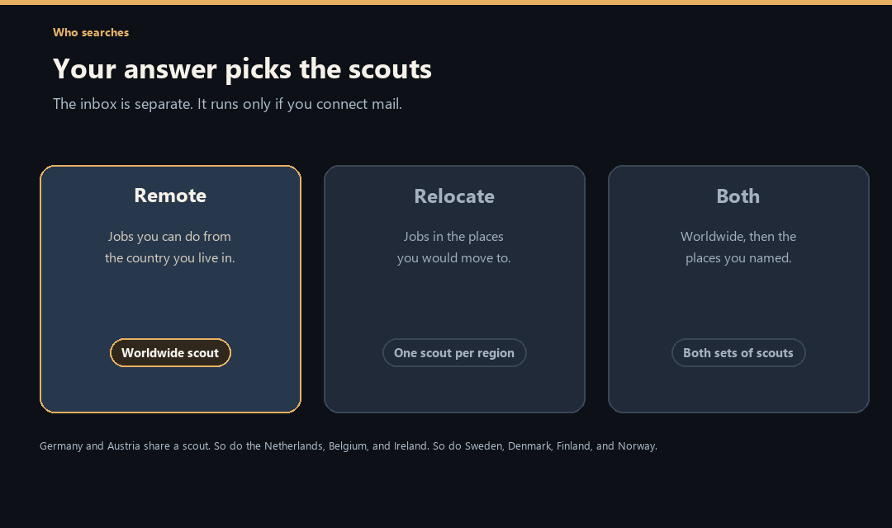
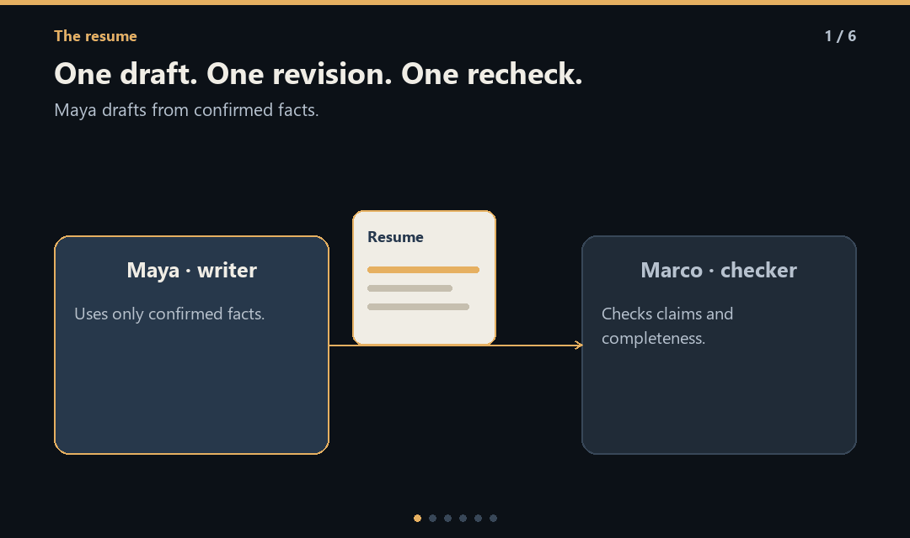
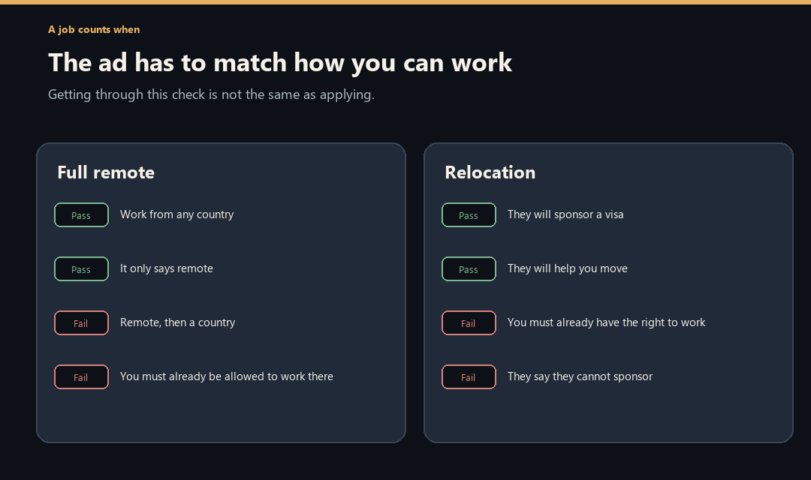

# job-search-agency

A small agency that looks for jobs, then stops and waits for you. You talk to one lead. The lead asks three questions, sends the team out, and comes back with at most three roles. Each role gets its own resume. Nothing is emailed and nothing is submitted until you say yes to a specific one.

Open this repo in Cursor, Claude, Codex, DeepSeek, or anything else that reads [`AGENTS.md`](AGENTS.md). That file is the contract. This page is the picture.

## A morning



1. You talk only to the lead.
2. The lead asks for your resume, whether you want remote work or relocation or both, and whether you can legally work that way. It reads the resume back and waits.
3. The inbox and the scouts start together. They hand back notes. They do not talk to each other.
4. Repeats, companies you already applied to, and rejections drop out. At most three jobs remain.
5. Each of those jobs gets a resume made from the same facts.
6. The run stops. You decide.

## Who goes looking



Germany and Austria share a scout. So do the Netherlands, Belgium, and Ireland. So do Sweden, Denmark, Finland, and Norway. The inbox runs only when you have connected mail. Without that, the search still runs.

## How a resume is checked



The writer may reorder and reword. It may not add a skill, a metric, or a job that was not in your general resume. A gap stays a gap. The visa line appears only on a relocation resume. The specialist sends findings once, the writer fixes once, and there is no third draft. A blocked resume is not saved. A recruiter who wrote with no specific opening gets the general resume you already gave.

## Which ads get through



A pass only means the text of the ad got through. It is not permission to apply. Jobs with US hours, or contract-only jobs, stay visible.

## What each one writes

You never talk to the workers. The only reply inside the agency is the one list of findings from the ATS specialist to the writer.

| Who | Writes |
| --- | --- |
| Inbox | `data/inbox.json`, and rejected companies in `data/roles.json` |
| Scouts | `data/scout-worldwide.json`, `data/scout-dach.json`, `data/scout-benelux-ie.json`, `data/scout-nordics.json` |
| Merger | `data/shortlist.json`, at most three cards |
| Writer | `outbox/<company>-<title>/cv.json` |
| ATS specialist | `outbox/<company>-<title>/ats.json` |

## First run

If `data/cv_facts.json` or `data/preferences.json` is missing, the lead stops. No scout runs. It asks, in this order:

1. **Your general resume.** A PDF, a text file, or a paste. It reads only what is written, shows you that reading, and waits for you to correct it. Then it saves `data/cv_facts.json`: contact, education, each role, the bullets you already have, languages, activities, and `never_add` (tools the resume does not claim).
2. **Your interest.** Full remote from where you already live, relocate, or both. Relocate asks which places. More than one place is normal.
3. **Work right, in your words.** Relocation: whether you need a visa. Full remote: that you will keep working from your current country. Saved in `data/preferences.json`.

Both files are gitignored. So is your inbox, your skip list, and every resume the morning writes. [`config/cv_facts.example.json`](config/cv_facts.example.json) and [`config/preferences.example.json`](config/preferences.example.json) are a fictional person, so the shape is visible. Do not put a real resume in them.

Someone who clones this repo starts with an empty skip list. Your applications are not theirs.

## Run a morning

Search uses Python 3.11 and the standard library. Rendering a resume also needs `python-docx`.

```bash
pip install -r requirements.txt
python tests/test_screen.py
python tests/test_agency.py
python src/morning.py
```

On Windows, if `python` is not on PATH, use `py -3` in place of `python`.

`morning.py` refuses to start while the two profile files are missing. After you have confirmed them, it reads the inbox when `~/.dsh/smtp.txt` exists (an address, then an app password), runs the scouts your answer turned on, merges them, and renders `resume.docx` and `resume.txt` for each resume that passes. Then it prints `Stopped. Nothing was submitted and nothing was sent.`

`python src/send.py` exits on purpose. There is no mail sender in this repository, and no LinkedIn client. Do not add one.

## Your own boards

Public Ashby, Lever, and Greenhouse boards only. Edit the lists under [`config/sources/`](config/sources/) or copy [`config/sources.example.yaml`](config/sources.example.yaml):

```bash
python src/discover.py --sources config/sources.example.yaml --rules config/rules.example.yaml
```

- `ashby`, `lever`, and `greenhouse` are lists of public board tokens.
- `location_tokens`, `title_allow`, and `seniority_block` are case-insensitive substrings.
- `cutoff_days` drops older ads. Greenhouse dates are last-updated, not first-published.
- A block phrase is masked before offer phrases are searched, so a sentence that refuses a visa is not read as an offer.

To keep a company off the shortlist, create `data/roles.json` (gitignored):

```json
{ "applied": ["northwind"], "rejected": ["example-corp"] }
```

The names are board tokens, compared case-insensitively.

## Layout

```
AGENTS.md          the contract every agent runtime follows
config/            fictional profile, rules, and board tokens
prompts/           writer and ATS specialist
src/morning.py     inbox, then scouts, then merge, then resumes
src/send.py        refuses
docs/              the diagrams on this page, and safety.md
data/              gitignored. created on your machine
outbox/            gitignored resumes, one folder per job
```

## Terms

Public posting APIs only, at most 8 concurrent requests, no login, no Apply click. Details are in [`docs/safety.md`](docs/safety.md).

## Licence

[MIT](LICENSE).
